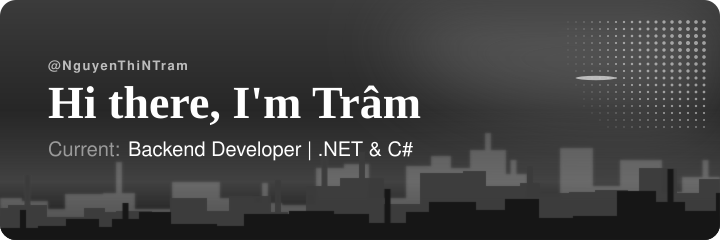
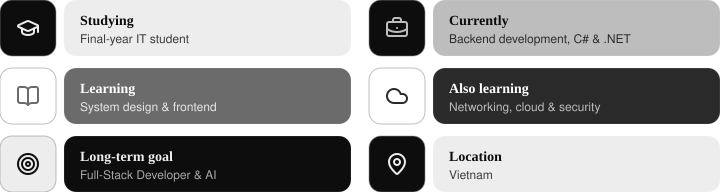

  

I'm a final-year IT student focusing on backend development with C# and .NET. I enjoy building APIs, working with databases, and turning ideas into working features.

I'm currently expanding my skills in system design, frontend development, networking, cloud, and security, with a long-term goal of becoming a Full-Stack Developer and moving into AI.

  

---

### `01` / Backend Language

 

---

### `02` / Database & ORM

  

---

### `03` / Cloud & Services

  

---

### `04` / Deploy

  

---

### `05` / Tool & IDE

    

---

  
  

  

  <i>Learning step by step, building things, and getting better through practice.</i>

---

I'm open to connecting with other students and developers, sharing what I've learned, and learning from different approaches to software development.

  
  &nbsp;
  

